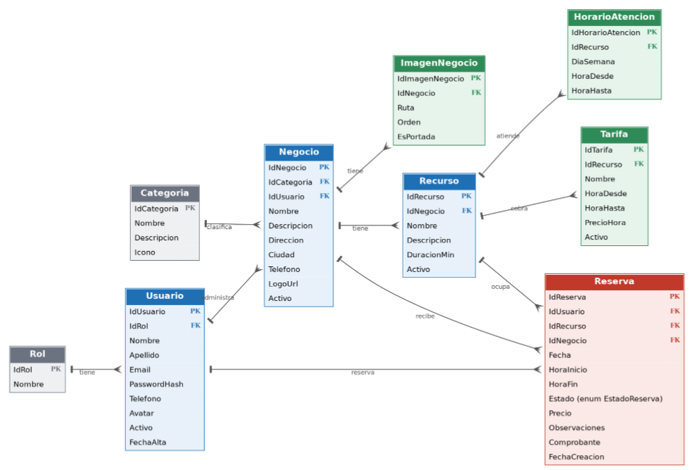
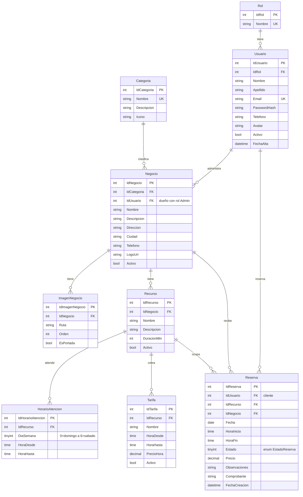

# 🏢 Proyecto Final Lab2 MVC

<h1 align="center">ReservAr</h1>
<p align="center"><em>Creamos un sistema de gestión de turnos. Principalmente orientado a Canchas de Fútbol</em></p>

## 🎯 Descripción del proyecto

**ReservAr** es una aplicación web para gestionar reservas de turnos en negocios que alquilan espacios por hora, principalmente **canchas de fútbol**, aunque el modelo sirve para cualquier rubro (pádel, salones, etc.).

### Problema que resuelve

Hoy muchos complejos deportivos coordinan los turnos por WhatsApp o por teléfono, con una grilla en papel o en una planilla. Eso genera superposición de horarios, errores en el precio y falta de control sobre qué turnos están ocupados. ReservAr centraliza todo:

- Los **clientes** buscan negocios por rubro, ven las fotos y los horarios disponibles, y reservan online. El precio se calcula solo según la tarifa vigente en cada tramo horario.
- Los **dueños** administran sus negocios, canchas, horarios, tarifas y fotos, y gestionan las reservas que reciben (confirmar, cancelar).
- El **superadministrador** controla usuarios, rubros, altas de negocios y solicitudes de nuevos dueños.

### Funcionalidades por rol

| Rol                   | Qué puede hacer                                                                                                                                                                                 |
| --------------------- | ----------------------------------------------------------------------------------------------------------------------------------------------------------------------------------------------- |
| **Usuario** (cliente) | Registrarse, buscar negocios por rubro y texto, reservar una cancha, ver y cancelar sus reservas, descargar el ticket, pedir ser dueño de un negocio (solicitud), editar su perfil y su avatar. |
| **Admin** (dueño)     | Gestionar sus negocios (datos, logo y galería de imágenes), sus canchas, horarios de atención y tarifas, y administrar las reservas de sus negocios.                                            |
| **SuperAdmin**        | Todo lo del Admin sobre cualquier negocio, más el ABM de usuarios, de categorías (rubros) y la aprobación de solicitudes.                                                                       |

### Tecnologías

- **Backend:** ASP.NET Core MVC (.NET 10), C#, ADO.NET con MySqlConnector
- **Base de datos:** MySQL 8
- **Autenticación:** cookies para la web y JWT Bearer para la API REST
- **Frontend:** Razor, Bootstrap 5 y Vue.js 3 (por CDN), con `fetch` para las llamadas AJAX
- **Pruebas de la API:** colección de Postman exportada en `docs/`

## 📅 Entrega

- Materia: Laboratorio de Software II
- Proyecto: Proyecto Integrador Final (ASP.NET Core MVC + MySQL)

## 👥 Integrantes

- _Hoyo, Jeremias - jeremiashoyo035@gmail.com - @Ego572 https://github.com/Ego572 - Discord: agony9999_
- _Mazza, Agustin - agusmazza@gmail.com - @AgustinMazza https://github.com/AgustinMazza - Discord: cote8942_
- _Rodríguez, Juan Cruz - juancruzrodriguez0@gmail.com - @JuanCRodriguez0 https://github.com/JuanCRodriguez0 - Discord: juancruzr_

## 📊 Modelado de Datos

_A continuación se presenta el esquema del modelo de datos correspondiente a la aplicación._

### _Diagrama de Entidad-Relación (DER)_





## 💾 Pasos a seguir para levantar la BD

### 1. Requisitos Previos

- .NET SDK 10.0 o superior
- MySQL Server 8.0 o superior
- IDE recomendado: Visual Studio Code
- Interfaz recomendada para la Base de Datos: DBeaver

### 2. Base de Datos

## 🗄️ Configuración de la Base de Datos (DBeaver)

1. **Conectarse al servidor:**
   - Abrir DBeaver y conectarse al servidor MySQL local.
   - No hace falta crear la base a mano: el script `init.sql` la crea solo (`reservar`).

2. **Ejecutar el Script SQL:**
   - Abrir el archivo `init.sql` ubicado en la carpeta `/Scripts` del proyecto.
   - Copiar todo su contenido.
   - En DBeaver, con la conexión al servidor seleccionada, ir al menú **SQL Editor** $\rightarrow$ **New SQL Script**.
   - Pegar el contenido del script.
   - Ejecutar todo el script presionando el botón **Execute Script** (el ícono con la hoja y el rayo naranja) o `Alt + X`.
   - El script se puede ejecutar las veces que haga falta, pero **borra y recrea las tablas**, así que se pierden los datos que hubiera cargado.

3. **Verificar Tablas:**
   - Hacer clic derecho sobre la base de datos `reservar` en DBeaver y seleccionar **Refresh** (`F5`).
   - Desplegar la sección **Tables** para confirmar la presencia de `roles`, `categorias`, `usuarios`, `negocios`, `imagenes_negocio`, `recursos`, `horarios_atencion`, `tarifas` y `reservas`.

### 3. Cadena de conexión rapida

El archivo `appsettings.json` no se sube al repositorio porque contiene la contraseña de cada uno. En su lugar hay un molde, `appsettings.json.example`:

1. Copiar el molde con el nombre real. Desde la raíz del repositorio:

```bash
   cp appsettings.json.example ReservAr/appsettings.json
```

2. Abrir `ReservAr/appsettings.json` y reemplazar `TuUsuario` y `TuContraseña` por los datos de tu MySQL local:

```json
   "DefaultConnection": "Server=localhost;Port=3306;Database=reservar;User=TuUsuario;Password=TuContraseña;"
```

## ▶️ Cómo correr el proyecto

```bash
cd ReservAr
dotnet restore
dotnet run
```

`dotnet run` muestra en la consola la dirección donde queda corriendo la aplicación (por ejemplo, `https://localhost:xxxx`).

## 🔑 Usuarios de prueba

Todos se cargan con el script `init.sql`.

| Rol                         | Email                   | Contraseña  |
| --------------------------- | ----------------------- | ----------- |
| SuperAdmin                  | superadmin@reservar.com | Super123!   |
| Admin (dueña de un negocio) | marta@reservar.com      | Admin123!   |
| Usuario (cliente)           | juan@reservar.com       | Usuario123! |
| Usuario (cliente)           | sofia@reservar.com      | Usuario123! |

## ✅ Matriz de evidencias de requerimientos mínimos

| Requerimiento mínimo                                                                        |   Estado    | Enlace al código / controladores                                                                                                                                                                                                                                                                                                                                                                                                                                                                                                                                                                                                                                                                                                                                                                                                                                                                                                                                                                                                            | Evidencia                                                                                                                                                                |
| ------------------------------------------------------------------------------------------- | :---------: | ------------------------------------------------------------------------------------------------------------------------------------------------------------------------------------------------------------------------------------------------------------------------------------------------------------------------------------------------------------------------------------------------------------------------------------------------------------------------------------------------------------------------------------------------------------------------------------------------------------------------------------------------------------------------------------------------------------------------------------------------------------------------------------------------------------------------------------------------------------------------------------------------------------------------------------------------------------------------------------------------------------------------------------------- | ------------------------------------------------------------------------------------------------------------------------------------------------------------------------ |
| **1. Modelo de datos** (9 tablas con relaciones 1:N y una entidad que depende de otras dos) | ✅ Cumplido | [`init.sql`](https://github.com/AgustinMazza/ProyFinalLab2/blob/main/ReservAr/Scripts/init.sql) · [`Models/`](https://github.com/AgustinMazza/ProyFinalLab2/blob/main/ReservAr/Models) · [`Models/Repositorios/`](https://github.com/AgustinMazza/ProyFinalLab2/blob/main/ReservAr/Models/Repositorios)                                                                                                                                                                                                                                                                                                                                                                                                                                                                                                                                                                                                                                                                                                                                     | DER en [`docs/DER.png`](docs/DER.png)                                                                                                                                    |
| **2. Login, roles y avatar**                                                                | ✅ Cumplido | [`AccountController.cs` (Login)](https://github.com/AgustinMazza/ProyFinalLab2/blob/main/ReservAr/Controllers/AccountController.cs#L38) · [Logout](https://github.com/AgustinMazza/ProyFinalLab2/blob/main/ReservAr/Controllers/AccountController.cs#L77) · [CambiarAvatar](https://github.com/AgustinMazza/ProyFinalLab2/blob/main/ReservAr/Controllers/AccountController.cs#L158) · [`Roles.cs`](https://github.com/AgustinMazza/ProyFinalLab2/blob/main/ReservAr/Helpers/Roles.cs) · [Función exclusiva de SuperAdmin](https://github.com/AgustinMazza/ProyFinalLab2/blob/main/ReservAr/Controllers/UsuariosController.cs#L11)                                                                                                                                                                                                                                                                                                                                                                                                           | Captura del perfil con avatar: [`docs/perfil-avatar.png`](docs/perfil-avatar.png)                                                                                        |
| **3. Manejo de archivos** (galería de imágenes del negocio, además del avatar)              | ✅ Cumplido | [`NegociosController.cs`](https://github.com/AgustinMazza/ProyFinalLab2/blob/main/ReservAr/Controllers/NegociosController.cs) · [`ImagenNegocio.cs`](https://github.com/AgustinMazza/ProyFinalLab2/blob/main/ReservAr/Models/ImagenNegocio.cs)                                                                                                                                                                                                                                                                                                                                                                                                                                                                                                                                                                                                                                                                                                                                                                                              | GIF subiendo imágenes a un negocio: [`docs/negocio-imagenes.gif`](docs/negocio-imagenes.gif)                                                                             |
| **4. ABM con Vue.js + AJAX** (Negocios: listar, alta, modificación y baja sin recargar)     | ✅ Cumplido | [`Views/Negocios/Index.cshtml`](https://github.com/AgustinMazza/ProyFinalLab2/blob/main/ReservAr/Views/Negocios/Index.cshtml) · [`negocios.js`](https://github.com/AgustinMazza/ProyFinalLab2/blob/main/ReservAr/wwwroot/js/negocios.js) · [`Listar`](https://github.com/AgustinMazza/ProyFinalLab2/blob/main/ReservAr/Controllers/NegociosController.cs#L42) · [`Guardar`](https://github.com/AgustinMazza/ProyFinalLab2/blob/main/ReservAr/Controllers/NegociosController.cs#L93) · [`Baja`](https://github.com/AgustinMazza/ProyFinalLab2/blob/main/ReservAr/Controllers/NegociosController.cs#L161)                                                                                                                                                                                                                                                                                                                                                                                                                                     | GIF del ABM en dos partes: [alta y modificación](docs/abm-vue-parte1.gif) · [baja y reactivación](docs/abm-vue-parte2.gif)                                               |
| **5. Paginado por servidor**                                                                | ✅ Cumplido | [`ReservasController.ListarMias`](https://github.com/AgustinMazza/ProyFinalLab2/blob/main/ReservAr/Controllers/ReservasController.cs#L266) · [`RepositorioReserva.ListarDeUsuario` (`LIMIT/OFFSET`)](https://github.com/AgustinMazza/ProyFinalLab2/blob/main/ReservAr/Models/Repositorios/RepositorioReserva.cs#L93) · [`misreservas.js`](https://github.com/AgustinMazza/ProyFinalLab2/blob/main/ReservAr/wwwroot/js/misreservas.js#L22) · [`NegociosController.Listar`](https://github.com/AgustinMazza/ProyFinalLab2/blob/main/ReservAr/Controllers/NegociosController.cs#L42) · [`RepositorioNegocio.ListarPaginado` (`LIMIT/OFFSET`)](https://github.com/AgustinMazza/ProyFinalLab2/blob/main/ReservAr/Models/Repositorios/RepositorioNegocio.cs#L387) · [`UsuariosController.Listar`](https://github.com/AgustinMazza/ProyFinalLab2/blob/main/ReservAr/Controllers/UsuariosController.cs#L31) · [`CatalogoController.Listar`](https://github.com/AgustinMazza/ProyFinalLab2/blob/main/ReservAr/Controllers/CatalogoController.cs#L22) | Captura del listado "Mis reservas" con el inspector de red enviando `pagina=2`: [`docs/paginado-network.png`](docs/paginado-network.png)                                 |
| **6. Selección asíncrona de entidades relacionadas** (dueño del negocio)                    | ✅ Cumplido | [`NegociosController.BuscarDuenios`](https://github.com/AgustinMazza/ProyFinalLab2/blob/main/ReservAr/Controllers/NegociosController.cs#L79) · [`negocios.js` (búsqueda con pausa de 300 ms)](https://github.com/AgustinMazza/ProyFinalLab2/blob/main/ReservAr/wwwroot/js/negocios.js#L54) · [`RepositorioUsuario.BuscarPorRol`](https://github.com/AgustinMazza/ProyFinalLab2/blob/main/ReservAr/Models/Repositorios/RepositorioUsuario.cs)                                                                                                                                                                                                                                                                                                                                                                                                                                                                                                                                                                                                | GIF buscando dueños en el desplegable: [`docs/busqueda-asincrona.gif`](docs/busqueda-asincrona.gif)                                                                      |
| **7. Web API REST con JWT**                                                                 | ✅ Cumplido | [`Program.cs` (config JWT)](https://github.com/AgustinMazza/ProyFinalLab2/blob/main/ReservAr/Program.cs#L32) · [`AuthApiController`](https://github.com/AgustinMazza/ProyFinalLab2/blob/main/ReservAr/Controllers/Api/AuthApiController.cs#L29) · [`NegociosApiController`](https://github.com/AgustinMazza/ProyFinalLab2/blob/main/ReservAr/Controllers/Api/NegociosApiController.cs) · [`UsuariosApiController`](https://github.com/AgustinMazza/ProyFinalLab2/blob/main/ReservAr/Controllers/Api/UsuariosApiController.cs)                                                                                                                                                                                                                                                                                                                                                                                                                                                                                                               | Postman con Bearer Token: [`docs/postman-jwt.png`](docs/postman-jwt.png) · colección en [`docs/ReservAr.postman_collection.json`](docs/ReservAr.postman_collection.json) |

**Notas sobre el cumplimiento**

- **Punto 1:** el modelo tiene 9 tablas. Hay varias relaciones 1:N (por ejemplo `Negocio → Recurso → Tarifa`), y `Reserva` depende de otras dos entidades, `Usuario` y `Recurso`, además de `Negocio`.
- **Punto 6:** nunca se carga la lista completa de usuarios. El servidor devuelve como máximo 10 coincidencias por búsqueda. Las categorías y los roles se cargan en un `<select>` porque son tablas maestras muy pequeñas.
- **Punto 7:** la web usa cookies, por eso la API se prueba con la colección de Postman.

### 🌐 Endpoints de la API REST

| Método | Ruta                                         | Acceso                  | Descripción                    |
| ------ | -------------------------------------------- | ----------------------- | ------------------------------ |
| `POST` | `/api/auth/login`                            | Público                 | Devuelve el token JWT.         |
| `GET`  | `/api/auth/perfil`                           | Token válido            | Datos del usuario autenticado. |
| `GET`  | `/api/negocios?buscar=&idCategoria=&pagina=` | Token válido            | Listado paginado de negocios.  |
| `GET`  | `/api/usuarios?buscar=&pagina=`              | Token de **SuperAdmin** | Listado paginado de usuarios.  |

Para probarla: importar `docs/ReservAr.postman_collection.json` en Postman, definir la variable `baseUrl` (por ejemplo `https://localhost:xxxx`) y ejecutar primero el login con alguno de los usuarios de prueba.
