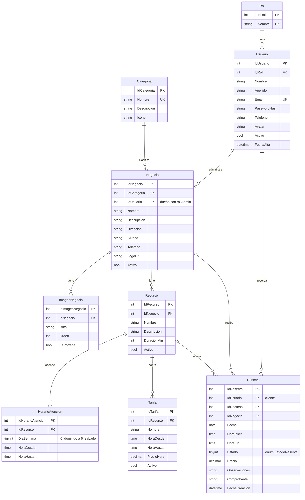

# 🏢 Proyecto Final Lab2 MVC
#ReservAr
### *Creamos un sistema de gestión de turnos. Principalmente orientado a Canchas de Futbol*    

## 📅 Entrega
- Materia: Laboratorio de Software II
- Proyecto: Proyecto Integrador Final (ASP.NET Core MVC + MySQL)
  
## 👥 Integrantes
- *Hoyo, Jeremias - jeremiashoyo035@gmail.com - @Ego572 https://github.com/Ego572 - Discord: agony9999*  
- *Mazza, Agustin - agusmazza@gmail.com - @AgustinMazza https://github.com/AgustinMazza - Discord: cote8942*  
- *Rodríguez, Juan Cruz - juancruzrodriguez0@gmail.com - @JuanCRodriguez0 https://github.com/JuanCRodriguez0 - Discord: juancruzr*  


## 📊 Modelado de Datos

*A continuación se presenta el esquema del modelo de datos correspondiente a la aplicación.*

### *Diagrama de Clases* 


## 💾 Pasos a seguir para levantar la BD

### 1. Requisitos Previos
* .NET SDK 10.0 o superior
* MySQL Server 8.0 o superior
* IDE recomendado: Visual Studio Code
* Interfaz recomendada para la Base de Datos: DBeaver

### 2. Base de Datos
## 🗄️ Configuración de la Base de Datos (DBeaver)

1. **Conectarse al servidor:**
   * Abrir DBeaver y conectarse al servidor MySQL local.
   * No hace falta crear la base a mano: el script `init.sql` la crea solo (`reservar`).

2. **Ejecutar el Script SQL:**
   * Abrir el archivo `init.sql` ubicado en la carpeta `/Scripts` del proyecto.
   * Copiar todo su contenido.
   * En DBeaver, con la conexión al servidor seleccionada, ir al menú **SQL Editor** $\rightarrow$ **New SQL Script**.
   * Pegar el contenido del script.
   * Ejecutar todo el script presionando el botón **Execute Script** (el ícono con la hoja y el rayo naranja) o `Alt + X`.
   * El script se puede ejecutar las veces que haga falta, pero **borra y recrea las tablas**, así que se pierden los datos que hubiera cargado.

3. **Verificar Tablas:**
   * Hacer clic derecho sobre la base de datos `reservar` en DBeaver y seleccionar **Refresh** (`F5`).
   * Desplegar la sección **Tables** para confirmar la presencia de `roles`, `categorias`, `usuarios`, `negocios`, `imagenes_negocio`, `recursos`, `horarios_atencion`, `tarifas` y `reservas`.

### 3. Cadena de conexión rapida

El archivo `appsettings.json` no se sube al repositorio porque contiene la contraseña de cada uno. En su lugar hay un molde, `appsettings.json.example`:

1. Copiar el molde con el nombre real. Desde la raíz del repositorio:
```bash
   cp ReservAr/appsettings.json.example ReservAr/appsettings.json
```
2. Abrir `ReservAr/appsettings.json` y reemplazar `TuUsuario` y `TuContraseña` por los datos de tu MySQL local:
```json
   "DefaultConnection": "Server=localhost;Port=3306;Database=reservar;User=TuUsuario;Password=TuContraseña;"
```


## ▶️ Cómo correr el proyecto

```bash
cd ReservAr
dotnet restore
dotnet run
```

`dotnet run` muestra en la consola la dirección donde queda corriendo la aplicación (por ejemplo, `https://localhost:xxxx`).
